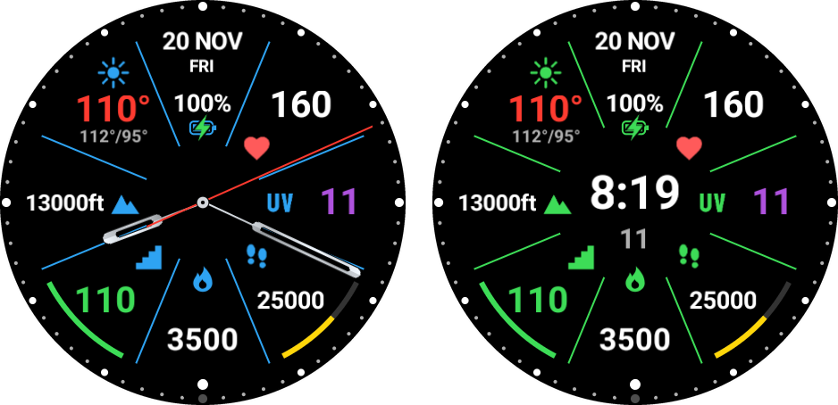

# DataDial for Wear OS

Watch face for the Google Pixel Watch 5 (Wear OS 7), ported from the Connect IQ
[DataDial](https://github.com/ls6777/garmin-datadial) for the Garmin fēnix 9. Eight stats
around the dial, with the time shown either as analog hands or as a large digital time in
the middle (analog by default), and the same stats as the Garmin version.

It comes as two apps: the watch face itself, and **DataDial Stats**, a small companion app that
supplies the stats Wear OS doesn't give watch faces (calories, floors and elevation).

It is built with the [Watch Face Format](https://developer.android.com/training/wearables/wff)
(version 4), which Google requires for watch faces. It runs on any round Wear OS 6 or later
watch.



*Test build (`./build.sh test`) on the Wear OS 7 emulator: analog with the default blue
(left) and digital with the green accent (right), at the test build's fixed time of 8:19:11,
which keeps the hands clear of the stats. The test build shows the same fixed values as the
Garmin test build: 25,000 steps (60% of the goal), heart rate 160, 100% battery while
charging, sunny and 110 °F (hot; high 112 °F, low 95 °F), 3,500 calories, 110 floors (goal
met) and 13,000 ft, plus UV index 11 (extreme).*

## The face

Same layout as the Garmin version: a dot for every minute around the edge, eight stats
divided by colored lines, each with an icon toward the center and a white value toward the
edge, see-through steel hands with a red seconds hand, or a digital time with seconds below.
The battery moves into the 12 o'clock section, under the date.

| Section | Garmin DataDial | Wear OS DataDial |
|---|---|---|
| 12 o'clock | Date, weekday | Same, plus the battery % under them |
| 1:30 | Heart rate | Same |
| 3 o'clock | Battery %, days left | **UV index** from the weather; the battery % is at 12 o'clock |
| 4:30 | Steps, with goal gauge | Same |
| 6 o'clock | Calories | Same, from DataDial Stats |
| 7:30 | Floors, with goal gauge | Same, from DataDial Stats (goal: 10 floors) |
| 9 o'clock | Elevation | Same, from DataDial Stats (barometer) |
| 10:30 | Temperature (watch sensor) | **Weather**: condition icon, current temperature, today's high/low |

### DataDial Stats

A Watch Face Format face is XML with no code. Of the health stats it can only read steps and
heart rate (besides the battery and the weather): it has no calories, floors or elevation
(checked against Watch Face Format version 5).
DataDial Stats reads them and hands them to the face as
[complications](https://developer.android.com/training/wearables/wff/complications), which
DataDial uses by default:

- **Calories** and **floors** are today's totals, as live values: DataDial Stats hands the
  face the system's own daily calories and floors
  ([`PlatformHealthSources`](https://developer.android.com/reference/kotlin/androidx/wear/protolayout/expression/PlatformHealthSources)),
  and the system keeps them current on the face by itself, like steps. Calories include
  resting calories, as on Garmin. Wear OS has no floors goal, so the gauge uses Garmin's
  default goal of 10 floors.
- **Elevation** comes from the barometer, in feet where the watch's region uses US units and
  meters elsewhere. The barometer only knows air pressure, which changes with the weather, so
  DataDial Stats calibrates it to the altitude of a location fix: each time you open the app
  (if it may use the location), and whenever it finds a recent fix while updating.
  Uncalibrated, it assumes standard sea-level pressure, which can be off by a few hundred feet.

**How often they update.** DataDial Stats doesn't run all the time: Android starts it when it
has something to do, and it reads a value and stops. Calories and floors are live (above), so
they don't depend on it. Elevation is read from the barometer whenever
[Health Services](https://developer.android.com/health-and-fitness/guides/health-services)
wakes the app with new activity data (about once a minute on the emulator; Google doesn't
document the rate on a watch). The system is also supposed to ask for every stat every 5
minutes, but on the emulator it mostly doesn't, and waking the screen doesn't trigger a
reading.
`./build.sh statslog` shows each request and each Health Services delivery with its time.

After installing, open DataDial Stats once and tap **Allow access**: it needs physical
activity (for calories and floors) and, optionally, location (to calibrate the elevation).
The app's screen shows what each stat reads and when the elevation was last calibrated.

The 6, 7:30 and 9 o'clock sections are still complication slots: long-press the face, tap the
edit button, and pick any other data source an app on the watch provides. They're drawn in
DataDial's style: the source's icon in the accent color, its value in white, and the goal
gauge along the edge for sources that report progress toward a target (ranged or goal
values). A source with no data at the moment shows nothing; with no source chosen, the
section shows `--`. Without DataDial Stats installed, they default to sunrise/sunset, unread
notifications and a world clock.

- **Battery:** under the date and weekday, the percentage above an outline filled to the
  charge level; below 20% both turn red. A green bolt appears over the outline while charging.
- **UV index:** the current UV index from the watch's weather, in WHO risk colors from high
  up: orange from 6, red from 8, purple from 11 (white below 6). Without weather data it
  shows `--`.
- **Goals:** the steps gauge (and the gauge of a goal or ranged complication) fills from its
  lower end toward the goal: red below 30%, yellow below 90%, green from 90%. Once the goal
  is met, the value turns green too.
- **Weather:** an icon for the current condition (sunny or clear, partly cloudy, cloudy, fog,
  mist, light rain, rain, heavy rain, light snow, snow, heavy snow, sleet, thunderstorm,
  windy; the sun becomes a moon at night) and the current temperature in the watch's
  weather unit. Below 40 °F (4.4 °C) the temperature turns ice blue; above 90 °F (32.2 °C)
  it turns red. Under it, today's high and low in gray ("72°/58°"). The three are stacked
  in a column: icon, temperature, high/low. Without weather data it shows just `--` (the
  thermometer appears only if the weather reports an unknown condition). The weather comes
  from the watch (which gets the location from the phone), the same data as the UV index.
- **Always-on mode:** only the dimmed dot dial and the hands (or the digital time) are shown,
  no stats, lines or seconds. The Garmin version's 2-pixel burn-in shift isn't ported.

## Settings

Long-press the face and tap the edit button (or use the watch face settings in the Pixel Watch
app on the phone):

| Setting | What it changes | Default |
|---|---|---|
| Clock style | Analog (hands) or Digital (time in the middle) | Analog |
| Lines and icons color | Divider lines, icons and the battery outline | Blue |
| Heart rate icon color | Heart icon only | Red |
| Complications | The 6, 7:30 and 9 o'clock stats | Calories, floors, elevation |

The colors are the same ten as on Garmin: Blue, Cyan, Green, Yellow, Orange, Red, Pink,
Purple, White and Gray. The digital time follows the watch's 12/24-hour setting.

## How it's built

Watch Face Format is declarative XML with no code. DataDial's layout is computed from the
screen radius, so `tools/generate.py` writes the XML from the same proportions as the Garmin
version, and renders the images (icons from `art/`, the steel hands, the bolt and the
weather icons) with Pillow. It also writes DataDial Stats' icons from the same `art/` files.
Edit the script, not the generated files.

DataDial Stats (`stats/`) is a separate Kotlin app, because a Watch Face Format bundle can't
contain code.

| File | Purpose |
|---|---|
| `tools/generate.py` | Writes `res/raw/watchface.xml` and the images in `res/drawable/` |
| `art/` | Icon SVGs, shared with the Garmin version |
| `build.sh` | Generate, build, install, test build, runtime log |
| `watchface/src/main/AndroidManifest.xml` | Package, Watch Face Format version 4, no code |
| `watchface/src/main/res/raw/watchface.xml` | The watch face (generated) |
| `watchface/src/main/res/xml/watch_face_info.xml` | Preview image and picker settings |
| `watchface/src/main/res/values/strings.xml` | Names shown in the editor |
| `watchface/src/main/res/drawable/preview.png` | Picker and store preview (an emulator capture of the test build) |
| `stats/src/main/kotlin/.../Sources.kt` | DataDial Stats' three complication data sources |
| `stats/src/main/kotlin/.../Health.kt` | Daily calories and floors from Health Services |
| `stats/src/main/kotlin/.../Elevation.kt` | Barometric elevation and its calibration |
| `stats/src/main/kotlin/.../Sensors.kt` | One-shot sensor readings |
| `stats/src/main/kotlin/.../MainActivity.kt` | Permissions and status screen |
| `stats/src/debug/` | Debug build only: switch for the fixed test values |

## Build

Needs Android Studio (for its JDK; the Android SDK with API 36 platform and build tools), and
Python 3 with Pillow.

```sh
./build.sh          # generate and build the debug APKs (watch face and DataDial Stats)
./build.sh run      # also install both on the watch or emulator and make DataDial the active face
./build.sh test     # the same with fixed worst-case values, to check the layout
./build.sh release  # release bundles (.aab) for Google Play (set up release signing first)
./build.sh log      # the watch face runtime's log: XML and expression errors show up here
./build.sh statslog # DataDial Stats' log: when each stat is read, and its value
```

`./build.sh test` writes the normal XML back when it's done, so the test values never stay in
the source, and switches on DataDial Stats' test values (a switch only the debug build has).
Run `./build.sh run` afterwards to put the live face and live stats back on the watch.

DataDial Stats is installed before the face: the face only picks up its default data sources
if they're installed when it is.

The project also opens in Android Studio, which checks the watch face XML as you edit it.

## Run on the emulator or the watch

- **Emulator:** create a Wear OS 7 large round device (Device Manager in Android Studio, or
  `avdmanager create avd -k "system-images;android-37.0;android-wear-signed;x86_64" -d wearos_large_round`),
  start it, then `./build.sh run`.
- **Pixel Watch 5:** turn on Developer options (Settings → System → About → Versions, tap
  Build number seven times), then Developer options → Wireless debugging → Pair new device.
  On the PC: `adb pair <ip>:<port>` with the shown code, then `adb connect <ip>:<port>` with
  the port shown on the Wireless debugging screen, and `./build.sh run`.

A watch face changed with `./build.sh run` keeps its settings and complications. To get the
defaults again, uninstall it first (`adb uninstall io.github.ls6777.datadial`). On the
emulator, you can grant DataDial Stats' permissions without the app:
`adb shell pm grant io.github.ls6777.datadial.stats android.permission.ACTIVITY_RECOGNITION`.
